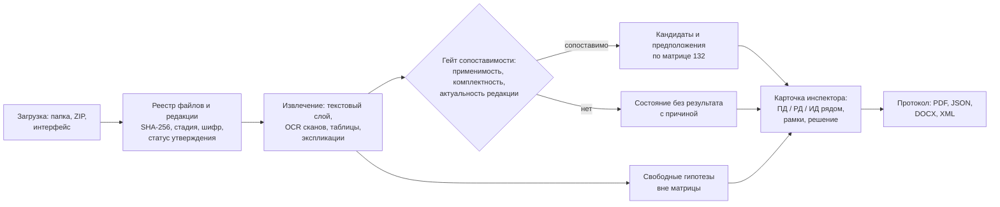

# CASE10 «ИИ-инспектор»: сверка ПД, РД и ИД по матрице из 132 параметров

Решение команды для хакатона ЛЦТ 2026 (кейс Мосгосстройнадзора). Сервис сверяет рабочую (РД) и исполнительную (ИД)
документацию с проектной (ПД) по матрице редакции 1.1 (коды `M-001`…`M-132`), показывает инспектору доказательство
каждой находки и выпускает протокол по Приложению 2 и JSON по `submission_schema.json`. Всё работает локально, без сети.

**Быстрые ссылки:** [Запуск одной командой](#2-запуск-одной-командой) ·
[Инструкция проверяющего](README_GRADER.md) · [Развёртывание](DEPLOYMENT.md) · [Лицензии и модели](LICENSES_MODELS.md) ·
[Соответствие ТЗ](TZ_TRACEABILITY.md) · [Демо-стенд](deploy/demo/README_DEMO.md)

---

## 1. Что это и как работает за 30 секунд

**Задача.** В комплекте тысячи страниц PDF трёх стадий. Инспектору нужно найти, где рабочая или исполнительная
документация расходится с проектной, и оформить это протоколом.

**Подход.**

- **ПД — эталон.** РД и ИД сравниваются с ней по 132 параметрам матрицы; для каждого параметра в каталоге записаны
  триггер нарушения и допустимые разделы.
- **Каждое утверждение с доказательством:** файл, SHA-256, страница, прямоугольник на странице (`bbox_norm` — доли
  ширины и высоты видимой страницы, с учётом CropBox и поворота).
- **Решает инспектор.** Система выдаёт кандидатов; статус `CONFIRMED_VIOLATION` ставит только человек.
- **Три уровня выдачи** (найти важнее, чем точно классифицировать):
  1. **нарушение-кандидат** — значения сопоставлены, условие триггера выполнено, оговорок нет;
  2. **предположение** — расхождение видно, но есть названная оговорка (неоднозначная редакция или привязка, порог не задан
     матрицей); проверяет инспектор;
  3. **свободная гипотеза** — расхождение вне матрицы (ТЗ 9.5), в отдельном массиве, не считается нарушением.
- **Честные состояния.** Нечитаемое или несопоставимое не превращается в нарушение или в «всё в порядке»: система
  отвечает `COMPARISON_IMPOSSIBLE` / `CLARIFICATION_REQUIRED` / `MISSING_EVIDENCE` и называет причину.
- **Офлайн.** Модель эмбеддингов и Tesseract лежат в образе; внешних LLM, VLM и OCR-сервисов нет.

**Поток данных.**



Тот же поток словами: загрузка → реестр и редакции → извлечение → гейт сопоставимости → кандидаты, предположения и
гипотезы → карточка инспектора → протокол (PDF, JSON, DOCX, XML).

---

## 2. Запуск одной командой

```bash
git clone https://github.com/Ivanqo/LCT-2026-10case.git
cd LCT-2026-10case
```

```bash
docker compose -f docker-compose.case10.yml up -d --build
```

| Что | Адрес |
|---|---|
| Интерфейс инспектора | http://127.0.0.1:3100 |
| API (Swagger) | http://127.0.0.1:8000/docs |
| Внешний контракт API (шлюз) | http://127.0.0.1:8080/openapi.json |
| Состояние | http://127.0.0.1:8000/health |

Демо-вход: `admin` / `Case10-Demo-2026` (меняется в `.env` до первого старта, см. [README_GRADER.md](README_GRADER.md)).
Сеть нужна только при сборке образов (базовые образы, зависимости, веса MiniLM); работающему сервису она не нужна.
Пакетный запуск без стенда и без сети (`python -m app.cli run`) — в [разделе 3.4](#34-инструкция-запуска).

---

## 3. Технический комплект

Чек-лист по ожиданиям экспертов. Каждый пункт — одна строка и ссылка на подробности.

### 3.1 Исходный код

| Каталог | Что внутри |
|---|---|
| `api_service/app/` | Python-движок (FastAPI): загрузка и реестр, извлечение, сравнение, доказательства, протокол, CLI (`cli.py`), воркер очереди (`worker_case10.py`) |
| `api_service/app/domain/` | предметная логика: `official_evidence.py`, `comparison_gate.py`, `live_candidate_tagger.py`, `explication_compare.py`, `room_drawing_compare.py`, `free_hypotheses/`, `sheet_compare/`, `protocol_annex2.py`, `inspector_card.py` |
| `api_service/tests/` | автотесты |
| `node_gateway/` | шлюз Node.js: внешний контракт API (`openapi.json`), прокси к движку |
| `frontend_react/` | интерфейс инспектора (React 18, Vite 5) |
| `evaluation/` | экспорт результата, метрики, проверка формулировок (`check_claims.py`), отчёты замеров (`evaluation/phase12/`) |
| `deploy/` | стенд, сборка комплекта поставки (`make_delivery.py`), демо-инструменты |
| `docker-compose.case10.yml` | стенд поставки |

Полное дерево — в [разделе 9](#9-структура-репозитория).

### 3.2 Зависимости

- Python: [`api_service/requirements.txt`](api_service/requirements.txt), точные версии — [`api_service/constraints.txt`](api_service/constraints.txt).
  `torch` ставится в [`api_service/Dockerfile`](api_service/Dockerfile) отдельным шагом (колесо CUDA 12.1 работает и без GPU).
- Интерфейс: [`frontend_react/package.json`](frontend_react/package.json), версии зафиксированы в `package-lock.json`.
- Шлюз: Node.js без сторонних npm-зависимостей ([`node_gateway/package.json`](node_gateway/package.json)).
- Очередь заданий стенда: RabbitMQ 3 (образ `rabbitmq:3-management`).

### 3.3 Dockerfile и образ

| Образ | Откуда | Размер и время сборки |
|---|---|---|
| `case10-api` (цель `delivery`) | [`api_service/Dockerfile`](api_service/Dockerfile) | 3,63 ГБ по `docker image inspect`; сборка 1 583 с (≈ 26 мин) со скачиванием ≈ 3 ГБ зависимостей — замер [E2](evaluation/phase12/FINAL_ACCEPTANCE_E2_REPORT.md) |
| `case10-gateway` | [`node_gateway/Dockerfile`](node_gateway/Dockerfile) | 61 МБ, 34 с — тот же замер |
| `case10-ui` | [`frontend_react/Dockerfile`](frontend_react/Dockerfile) | 21 МБ, 228 с — тот же замер |

Сборка стенда и образа API отдельно:

```bash
docker compose -f docker-compose.case10.yml build
docker build -f api_service/Dockerfile --target delivery -t case10-api .
```

Холодная сборка без кэша слоёв в замерах не выполнялась; время зависит от канала. Для сборки нужна сеть
(перечень источников — отчёт E2, раздел 7); после сборки сервис запускается с `--network none`.

### 3.4 Инструкция запуска

**Стенд (интерфейс инспектора и API)** — команда из [раздела 2](#2-запуск-одной-командой). Проверка:

```bash
docker compose -f docker-compose.case10.yml ps
curl -s http://127.0.0.1:8000/health
```

**Пакетный запуск без сети.** Расположите файлы так (реестр — вне папки с документами, пути в нём относительные
к `documents`):

```text
case10-input/documents/{ПД,РД,ИД}/...
case10-registry/registry.csv
case10-output/
```

```bash
docker build -f api_service/Dockerfile -t case10-api .
docker run --rm --network none \
  -v "$PWD/case10-input/documents:/in/docs:ro" \
  -v "$PWD/case10-registry:/in/registry:ro" \
  -v "$PWD/case10-output:/out" \
  case10-api python -m app.cli run --docs /in/docs --registry /in/registry/registry.csv \
  --out /out/result.json --timings /out/timings.json
```

Проверка готового файла и самопроверка на сгенерированных PDF (это проверка работоспособности, не метрика качества):

```bash
docker run --rm --network none -v "$PWD/case10-output:/out:ro" case10-api python -m app.cli validate /out/result.json
docker run --rm --network none case10-api python -m app.cli selftest
```

Формат реестра, коды выхода и режимы входа — в [README_GRADER.md](README_GRADER.md), разделы 1–2.

**Требования к железу.** Приёмка не установила минимальных CPU, RAM и места на диске; GPU не обязателен. Для ориентира —
измерения [E2](evaluation/phase12/FINAL_ACCEPTANCE_E2_REPORT.md) (CLI в Docker, `--cpus 8 --memory 10g`, машина под
фоновой нагрузкой): пиковая память дерева процессов от 2 188 МБ (NOV) до 5 179 МБ (DOO25); холодные прогоны NOV
115 с, ALT79B 110 с, TYU 205 с, OKT103 160 с; DOO25 (17 тыс. страниц, 6 ГБ) тёплый 435 с. Время сильно зависит от диска:
пакет на смонтированном каталоге Docker Desktop читается заметно медленнее нативного.

### 3.5 Модели, веса и лицензии

| Компонент | Где | Лицензия |
|---|---|---|
| `paraphrase-multilingual-MiniLM-L12-v2` — эмбеддинги для подтверждения якорей и семантических гипотез | в образе (кэш HF, `HF_HUB_OFFLINE=1`) | Apache-2.0 |
| Tesseract 5.5 с языками `rus`, `eng`, `osd` — OCR сканов | в образе | Apache-2.0 |
| Qwen3-4B — необязательный локальный верификатор выбора кандидата | **не в образе**, выключен (`CASE10_LLM_VERIFIER_ENABLED=0`) | Apache-2.0 |

**Почему по умолчанию без LLM.** Это осознанный выбор. Критическая обработка локальная и детерминированная: два
прогона одного образа на одном пакете дают один SHA-256 результата, чего нельзя добиться от генеративной модели. Железо
проверяющих не закреплено, а веса 4 млрд параметров добавили бы ≈ 8 ГБ к образу и требовали бы GPU. LLM нужна там, где
значение нельзя извлечь правилом; для этого есть **опциональный путь**: локальный верификатор Qwen3-4B (режим «выключен»
или «тень»), результаты пилота — [LLM_CANDIDATE_VERIFIER_PILOT_REPORT.md](evaluation/LLM_CANDIDATE_VERIFIER_PILOT_REPORT.md).
Сводка библиотек, размеров и лицензий (включая AGPL-3.0 у PyMuPDF) — [LICENSES_MODELS.md](LICENSES_MODELS.md).

### 3.6 API

- Swagger движка: http://127.0.0.1:8000/docs; внешний контракт через шлюз: http://127.0.0.1:8080/openapi.json
  (файл в репозитории — [`node_gateway/openapi.json`](node_gateway/openapi.json)).
- Авторизация: `POST /api/auth/login` → токен (`Authorization: Bearer …`) или заголовок `X-API-Key`.

| Действие | Метод и путь |
|---|---|
| создать проект | `POST /api/projects` |
| загрузить файл через интерфейс | `POST /api/upload` |
| серверный пакет и реестр | `POST /api/case10/batch-runs` (движок, порт 8000) |
| создать и запустить процесс | `POST /api/case10/projects/{id}/processes`, `POST /api/case10/processes/{id}/run` |
| статус и прогресс | `GET /api/case10/processes/{id}/status`, `GET …/progress` |
| находки и доказательства | `GET /api/case10/evidence-groups`, `GET /api/case10/evidence-groups/{id}` |
| страница-первоисточник | `GET /api/case10/evidence-fragments/{id}/page.png` |
| решение инспектора | `POST /api/case10/evidence-groups/{id}/decisions` |
| протокол | `GET /api/case10/protocols/current`, `…/{id}/pdf`, `…/docx`, `…/xml`, `…/{id}/submission`, `POST …/{id}/finalize` |

Полная таблица и пример вызовов с `curl` — в [README_GRADER.md](README_GRADER.md), раздел 3.

### 3.7 Пример выходного JSON

Синтетический пример формы ответа — [`evaluation/phase12/example_submission_synthetic.json`](evaluation/phase12/example_submission_synthetic.json);
схема — [`evaluation/phase12/submission_schema.json`](evaluation/phase12/submission_schema.json). Пример не содержит
результатов по реальным объектам и не оценивает качество.

| Поле корня | Что содержит |
|---|---|
| `object_id` | идентификатор объекта |
| `checks` | проверки по матрице: по каждому из 132 кодов одна или несколько записей; пара «код + место» уникальна |
| `free_search_hypotheses` | свободные гипотезы (ТЗ 9.5): `violation_claimed=false`, не входят в `checks`; массив пуст, если гипотез нет |
| `quality_issues` | страницы с явной проблемой качества |
| `completeness` | отчёт о комплектности (статусы загрузки по стадиям) |
| `source_selection` | выбор источников при конфликте редакций |
| `export_conventions` | стиль кодов, версии матрицы, данных и модели, хэш входного манифеста |
| `package` | что прочитано: файлы, SHA-256, стадии, статус реестра (в результате CLI) |

В записи `checks`: `parameter_code` (`M-001`…`M-132`), `location`, `pd_value` / `rd_value` / `id_value`,
`violation_label` (`VIOLATION_PRESENT`, `NO_VIOLATION`, `MISSING_DOCUMENT`, `COMPARISON_IMPOSSIBLE`), `protocol_status`,
`evidence` и источники (`source_expected_*`, `source_actual_*`: файл, SHA-256, страница, рамка). Реальный результат
дополнительно содержит `evidence_tier` (уровень), `tier_reasons` (причины оговорки), `no_result_state`,
раздельные `text_confidence` и `link_confidence`, `deviation`, `rule`, `threshold`. Вероятность нарушения нигде не
заявляется. Описание формата — [README_GRADER.md](README_GRADER.md), раздел 4.

### 3.8 Тестовый стенд

- Поднимается командой из [раздела 2](#2-запуск-одной-командой); вход `admin` / `Case10-Demo-2026`.
- Загрузить пакет: через интерфейс (PDF и реестр; лимиты 50 МБ на файл и 200 МБ на пакет) либо серверным путём
  `POST /api/case10/batch-runs` (пакет в `./packages`, без лимитов) — [DEPLOYMENT.md](DEPLOYMENT.md), раздел 3.
- Публичный стенд на Ubuntu с HTTPS — [DEPLOYMENT.md](DEPLOYMENT.md), раздел 2.
- Демо-сценарий показа на реальных пакетах — [deploy/demo/README_DEMO.md](deploy/demo/README_DEMO.md); пакеты организатора в
  репозиторий не входят.
- Стенд проверен в браузере и в Docker: [FINAL_ACCEPTANCE_E2_REPORT.md](evaluation/phase12/FINAL_ACCEPTANCE_E2_REPORT.md),
  [FINAL_STAND_REPORT.md](evaluation/phase12/FINAL_STAND_REPORT.md).

---

## 4. Что вы получите на выходе

**Протокол по Приложению 2** (PDF, JSON, DOCX, XML строятся из одних данных; новые версии не затирают прежние):

1. загрузка документов: статусы по стадиям (`PD_UPLOADED`, `PD_PARTIAL`, `PD_MISSING` и т. д.), смешанные стадии,
   исключённые файлы, конфликты редакций;
2. статистика: сколько параметров матрицы проверено;
3. непроверенные параметры, с причиной;
4. критические нарушения;
5. существенные нарушения;
6. подозрения ИИ (предположения и гипотезы, отдельно от нарушений);
7. решение инспектора с комментарием и рекомендацией.

**Три уровня** в протоколе и в JSON различимы по `evidence_tier`: нарушение-кандидат, предположение (с причиной оговорки),
свободная гипотеза (отдельный массив `free_search_hypotheses`).

**Состояния без результата** (у каждого есть причина и доступное действие):

| Состояние | Когда |
|---|---|
| `NO_DOCUMENTS` | нет документов нужной стадии или раздела |
| `NO_VALUE_IN_DOCUMENT` | документ есть, значения в нём нет |
| `NOT_COMPARABLE` | значения несопоставимы (единицы, раздел, редакции) |
| `PROCESSING_ERROR` | страница или файл не обработаны (нечитаемый PDF, плохое качество) |
| `INCOMPLETE_CHECK` | проверка не завершена, нужно уточнение или дозагрузка |
| `NO_DIFFERENCE` | расхождения нет |

---

## 5. Как реализованы модули ТЗ

Краткая карта 12 модулей; подробная таблица с тестами, статусами и ограничениями по каждому пункту ТЗ —
[TZ_TRACEABILITY.md](TZ_TRACEABILITY.md). Статусы «частично» и «нет» там указаны прямо.

| № | Модуль ТЗ | Где в коде (от `api_service/app/`) | Как проверить (тесты в `api_service/tests/`) |
|---|---|---|---|
| 1 | Загрузка и парсинг | `batch_package.py`, `domain/file_registry.py`, `domain/live_candidate_tagger.py`, `api/routes_upload.py` | `test_case10_s3_file_registry.py`, `python -m app.cli run` |
| 2 | Сравнение и протокол | `domain/comparison_gate.py`, `domain/official_evidence.py`, `domain/protocol_annex2.py` | `test_case10_comparison_gate.py`, экспорт протокола |
| 3 | Верификация инспектором | `domain/inspector_card.py`, `domain/inspector_workbench.py`, `frontend_react/src/` | `test_case10_final_card.py`, `test_case10_s5_workbench.py`, интерфейс |
| 4 | Обратная связь и дообучение | `domain/training_release.py` | `test_case10_training_release.py` |
| 5 | Свободный поиск гипотез | `domain/free_hypotheses/`, `domain/logical_analysis.py` | `test_case10_free_hypotheses.py` |
| 6 | Интеграция с внешней ИС | `domain/iais_rin_sync.py` (эмуляция) | `test_case10_iais_rin_sync.py` |
| 7 | Дашборд инспектора | `domain/inspector_dashboard.py`, `frontend_react/src/components/Dashboard.jsx` | `test_case10_final_z_modules.py`, вкладка «Панель объектов» |
| 8 | Нормативная база | маршруты `/api/case10/normative-base`, `frontend_react/src/components/NormativeBase.jsx` | `test_case10_tz10_tables.py`, вкладка «Нормативная база» |
| 9 | Журнал аудита | `AuditLog` в `db/models.py`, `domain/v3_pipeline.py` | `test_upload_security.py`, `GET /api/case10/processes/{id}/audit` |
| 10 | Еженедельный отчёт ML | `domain/ml_weekly_report.py`, `domain/ml_weekly_scheduler.py` | `test_case10_final_z_weekly.py`, `python -m app.cli weekly-report` |
| 11 | Мониторинг и логирование | `logging_setup.py`, `metrics.py` | `GET /metrics`, `test_logging_json.py` |
| 12 | Обработка ошибок | `batch_package.py`, `domain/document_versions.py`, `domain/v3_jobs.py` | `test_case10_ocr_hardening.py`, `test_upload_security.py` |

---|---|---|---|
| 1 | Загрузка и парсинг | `domain/batch_package.py`, `file_registry.py`, `live_candidate_tagger.py`, `routes_upload.py` | `test_case10_s3_file_registry.py`, `python -m app.cli run` |
| 2 | Сравнение и протокол | `domain/comparison_gate.py`, `official_evidence.py`, `protocol_annex2.py` | `test_case10_comparison_gate.py`, экспорт протокола |
| 3 | Верификация инспектором | `domain/inspector_card.py`, `inspector_workbench.py`, `frontend_react/` | `test_case10_final_card.py`, `test_case10_s5_workbench.py`, интерфейс |
| 4 | Обратная связь и дообучение | `domain/training_release.py` | `test_case10_training_release.py` |
| 5 | Свободный поиск гипотез | `domain/free_hypotheses/`, `logical_analysis.py` | `test_case10_free_hypotheses.py` |
| 6 | Интеграция с внешней ИС | `domain/iais_rin_sync.py` (эмуляция) | `test_case10_iais_rin_sync.py` |
| 7 | Дашборд инспектора | `domain/inspector_dashboard.py`, `Dashboard.jsx` | `test_case10_final_z_modules.py`, вкладка «Панель объектов» |
| 8 | Нормативная база | `/api/case10/normative-base`, `NormativeBase.jsx` | `test_case10_tz10_tables.py`, вкладка «Нормативная база» |
| 9 | Журнал аудита | `AuditLog`, `v3_pipeline.add_audit` | `test_upload_security.py`, `GET …/processes/{id}/audit` |
| 10 | Еженедельный отчёт ML | `domain/ml_weekly_report.py`, `ml_weekly_scheduler.py` | `test_case10_final_z_weekly.py`, `python -m app.cli weekly-report` |
| 11 | Мониторинг и логирование | `logging_setup.py`, `app/metrics.py` | `GET /metrics`, `test_logging_json.py` |
| 12 | Обработка ошибок | `batch_package.py`, `document_versions.py`, `v3_jobs.py` | `test_case10_ocr_hardening.py`, `test_upload_security.py` |

---

## 6. Что изменено по отзывам экспертов

Источники: устный отзыв (16.10.2026) и письменный отзыв (17.10.2026) экспертов. Отчёты шагов лежат в `evaluation/phase12/`.

| Замечание | Что сделано | Где проверить |
|---|---|---|
| Значения перезаписываются: помещения с одинаковым номером затирают друг друга | Ключ помещения — корпус, этаж, номер; дубликат полного ключа даёт конфликт `DUPLICATE_ROOM_KEY`, а не молчаливую перезапись; результат не зависит от порядка файлов | [FINAL_A_ROOM_IDENTITY_REPORT.md](evaluation/phase12/FINAL_A_ROOM_IDENTITY_REPORT.md), `test_case10_room_identity.py` |
| Привязка системы к помещению по расстоянию и фиксированная уверенность 0,88 | Неоднозначная подпись остаётся без привязки (`AMBIGUOUS_SYSTEM_LINK`, список кандидатов); уверенность распознавания текста и уверенность привязки разделены | тот же отчёт, `test_case10_room_identity_rulepack.py` |
| Сравнение ловит только исчезновение системы | Добавленные и пропавшие системы выдаются раздельно; добавление нарушением не считается и объясняется (`composition_change_not_decisive`) | тот же отчёт; [FINAL_B_TIERS_REPORT.md](evaluation/phase12/FINAL_B_TIERS_REPORT.md) |
| Порог параметра M-002 не переносится на площади помещений | Порог 1 % для помещений убран; отклонение выдаётся предположением `threshold_not_set_by_matrix` с величиной отклонения | FINAL_B_TIERS_REPORT.md, `test_case10_s1_explication.py` |
| Перезапись значений в группах доказательств и метриках (устное замечание) | Исправлены группы доказательств, порядок файлов, воспроизводимость метрик | [FINAL_S1_OVERWRITE_REPORT.md](evaluation/phase12/FINAL_S1_OVERWRITE_REPORT.md) |
| Найти важнее, чем классифицировать | Три уровня выдачи; мягкий гейт: неоднозначность даёт предположение, а не воздержание; модуль свободных гипотез | FINAL_B_TIERS_REPORT.md, [FINAL_B2_HYPOTHESES_REPORT.md](evaluation/phase12/FINAL_B2_HYPOTHESES_REPORT.md), [FINAL_R_RECALL_REPORT.md](evaluation/phase12/FINAL_R_RECALL_REPORT.md) |
| Карточка по чек-листу: ПД, РД и ИД рядом, рамки, полный экран, разделение на части, дозагрузка, прогресс, 6 состояний без результата | 13 пунктов чек-листа закрыты в интерфейсе и API; проверено в браузере | [FINAL_CARD_AUDIT.md](evaluation/phase12/FINAL_CARD_AUDIT.md), [FINAL_DEMO_REPORT.md](evaluation/phase12/FINAL_DEMO_REPORT.md), снимки `evaluation/phase12/card_screens/` |
| Не склеивать листы по совпадению числа; стадию подтверждать по документу и реестру | Режим «Сравнение листов»: пары листов ПД↔РД и РД↔РД, процент сходства, области различий; уверенность пары, сходство и отклонение показываются раздельно | [FINAL_GRAPH_REPORT.md](evaluation/phase12/FINAL_GRAPH_REPORT.md) |
| Работа без LLM | Принято экспертами; оставлен опциональный локальный верификатор | [раздел 3.5](#35-модели-веса-и-лицензии) |

---

## 7. Измеренное качество и ограничения

Все числа привязаны к отчётам; что не измерено, так и сказано. Машина замеров общая, время ориентировочное.

| Что | Результат | Отчёт |
|---|---|---|
| Сквозная проверка тестами | 1137 прошли, 1 пропущен (на дату отчёта) | [FINAL_PAR_REPORT.md](evaluation/phase12/FINAL_PAR_REPORT.md) |
| Самопроверка в образе | 25 сценариев из 25 | [FINAL_ACCEPTANCE_E2_REPORT.md](evaluation/phase12/FINAL_ACCEPTANCE_E2_REPORT.md) |
| Совпадение Docker и хоста | массив `checks` совпал на 7 объектах | FINAL_ACCEPTANCE_E2_REPORT.md |
| Детерминизм | холодный и тёплый кэш, 4 и 8 CPU дают один SHA-256 результата | [FINAL_ACCEPTANCE_REPORT.md](evaluation/phase12/FINAL_ACCEPTANCE_REPORT.md) |
| Тюмень (ОВ по помещениям), M-078 | 13 карточек совпали с записанным набором `deploy/demo/expected/tyu.json`; набор составлен нами, это не полнота | FINAL_PAR_REPORT.md |
| Свободные гипотезы, точность UNMATCHED_DIFF | 20 из 21 на размеченной выборке (интервал Уилсона 0,77–0,99); 52 гипотезы на 62 300 страниц | [FINAL_B2_HYPOTHESES_REPORT.md](evaluation/phase12/FINAL_B2_HYPOTHESES_REPORT.md) |
| Детекторы листов изменений и составов слоёв, точность | 7 из 10 и 4 из 4 на малой размеченной выборке | [FINAL_R_RECALL_REPORT.md](evaluation/phase12/FINAL_R_RECALL_REPORT.md) |
| OCR, точность символов | текстовый слой 0,9576 (порог ТЗ 0,95 пройден); сканы Tesseract 0,7761 (ниже порога) | [OCR_FALLBACK_HARDENING_REPORT.md](evaluation/OCR_FALLBACK_HARDENING_REPORT.md) |
| Сопоставление листов, точность пар | 0,85 на новой выборке из 20 пар (нижняя граница интервала 0,64) | [FINAL_GRAPH_REPORT.md](evaluation/phase12/FINAL_GRAPH_REPORT.md) |
| Ответ `protocols/current` | в Docker p95 220–240 мс (порог ТЗ 200 мс не пройден); после правок на хосте p95 33–54 мс, в Docker не перемерено | FINAL_ACCEPTANCE_E2_REPORT.md, [FINAL_STAND_REPORT.md](evaluation/phase12/FINAL_STAND_REPORT.md) |

**Ограничения (честно):**

- **Полнота на скрытых данных не измерена.** Метрики считались на публичных объектах и размеченных выборках организатора;
  выборки малы, а recall на официальных примерах ниже порога ТЗ ([TZ_TRACEABILITY.md](TZ_TRACEABILITY.md), раздел 7).
- **OCR сканов ниже нормы ТЗ** (строка выше); сканы ИД без текстового слоя читаются плохо, и такие страницы получают
  `LOW_QUALITY` и состояние `PROCESSING_ERROR`, а не выдуманное значение.
- **Нет компьютерного зрения для чертежей:** чертежи ОВ сравниваются по текстовым меткам; растровое сравнение листов —
  только просмотр и метод `GRAPHIC_DIFF`, по умолчанию выключенный.
- **Значения из DOCX** извлекаются как текст без геометрии; находки из DOCX не строятся.
- **Интеграция с ИАИС «РиН» и УКЭП — эмуляция** на mock-сервере.
- Юзабилити-тест на пяти инспекторах не проводился.

**Следующие шаги:**

1. измерить полноту на новых документах и расширить разметку, чтобы доверительные интервалы сузились;
2. улучшить чтение сканов (подбор OCR-движка уже проверен в пилотах, см. отчёты `evaluation/OCR_*_REPORT.md`);
3. добавить компьютерное зрение для планов (масштаб, расстояния) поверх существующего сравнения листов;
4. перемерить p95 протокола в Docker после пересборки образа;
5. подключить настоящий контур ИАИС «РиН» и подпись УКЭП после получения доступа.

---

## 8. Воспроизводимость, безопасность и лицензии

**Воспроизводимость.** `result.json` не содержит времени, путей и идентификаторов базы. Два прогона одного образа на
одном пакете дают один SHA-256 при любом числе процессов и с холодным или тёплым кэшем (проверено на шести пакетах —
[FINAL_ACCEPTANCE_REPORT.md](evaluation/phase12/FINAL_ACCEPTANCE_REPORT.md)). Лимиты детерминированные (документы и
страницы, не секунды). Кэши лежат в томе `/data` (тэггер, качество страниц, экспликации, хэши файлов); сбросить их:

```bash
docker compose -f docker-compose.case10.yml down -v
```

Эта команда удаляет и базу стенда. Чтобы очистить только кэш, укажите новый каталог в `CASE10_LIVE_TAGGER_CACHE_DIR`
или удалите том отдельно (см. [DEPLOYMENT.md](DEPLOYMENT.md), раздел 4).

**Безопасность и локальность.** Критический путь не обращается в сеть: модели в образе, `HF_HUB_OFFLINE=1`, пакетный
запуск проверен с `--network none`. Роли (администратор, руководитель, инспектор, ML-инженер), журнал аудита с IP,
лимиты загрузки 50/200 МБ. Необязательное ужесточение контейнеров (`no-new-privileges`, `cap_drop ALL`, корневая ФС
только для чтения) — `docker-compose.case10.hardened.yml`. Шифрования данных в покое, резервного копирования и антивирусной
проверки нет — [TZ_TRACEABILITY.md](TZ_TRACEABILITY.md), раздел 6.

**Лицензии.** Код проекта и используемые библиотеки перечислены в [LICENSES_MODELS.md](LICENSES_MODELS.md). Для
коммерческого внедрения нужно учесть AGPL-3.0 у PyMuPDF (коммерческая лицензия Artifex или замена).

---

## 9. Структура репозитория

```text
api_service/          движок: app/ (API, domain/, db/), alembic/, tests/, Dockerfile, requirements.txt
node_gateway/         шлюз с внешним контрактом API (server.js, openapi.json)
frontend_react/       интерфейс инспектора (src/components/, Vite)
evaluation/           экспорт, метрики, check_claims.py, отчёты (phase12/ — отчёты финального этапа)
deploy/               case10/ (стенд, bootstrap), demo/ (сценарий показа), tools/, make_delivery.py
docker-compose.case10.yml          стенд поставки
docker-compose.case10.gpu.yml      оверлей GPU
docker-compose.case10.hardened.yml усиленный режим
README_GRADER.md  DEPLOYMENT.md  LICENSES_MODELS.md  TZ_TRACEABILITY.md   документы поставки
docs/legacy_services.md  описание исторических сервисов (RAG, IFC, лендинг), в поставку CASE10 не входят
```

Каталоги `rag_service/`, `ifc_service/`, `landing/`, `frontend/` и `docker-compose.yml` — исторические сервисы
разработки, к CASE10 не относятся: [docs/legacy_services.md](docs/legacy_services.md).

---

## 10. Как запустить тесты

Из корня репозитория, в окружении Python 3.11 с зависимостями из `api_service/requirements.txt` и `pytest`:

```bash
PYTHONPATH="api_service:." python -m pytest api_service/tests -q
```

В Windows PowerShell:

```powershell
$env:PYTHONPATH = "api_service;."; python -m pytest api_service/tests -q
```

Часть тестов требует установленного Tesseract с языком `rus` и модели MiniLM; без них такие тесты пропускаются или
падают на этапе окружения. Интерфейс: `cd frontend_react && npm ci && npm run lint && npm run build`.
Проверка формулировок документов поставки (числа без ссылки на замер, абсолютные утверждения, расхождение флагов с compose):

```bash
python evaluation/check_claims.py
```

---

## 11. Вопросы и поддержка

Вопросы по запуску и результатам — через issues этого репозитория на GitHub. При обращении приложите команду, версию
образа (`docker image ls case10-api`) и вывод `curl -s http://127.0.0.1:8000/health`; пакеты документов и реестры
не прикладывайте.
